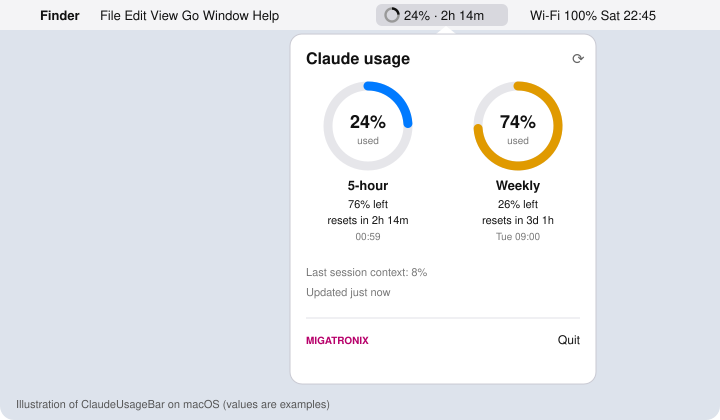
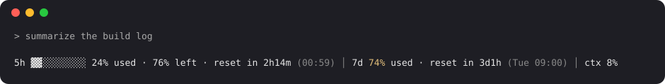
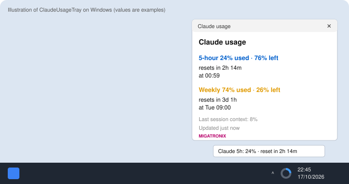
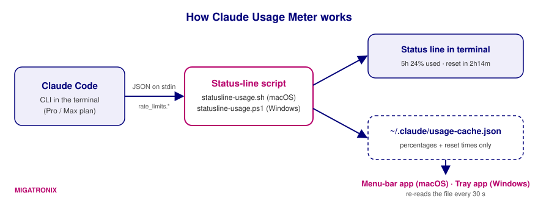

# Claude Usage Meter

See how much of your Claude plan you have used, how much is left, and when it resets — always visible on your desktop.

- **macOS:** a menu-bar item next to the clock, plus a usage line in the Claude Code terminal.
- **Windows:** a tray icon next to the clock, plus the same usage line in the terminal.

Developed by **MIGATRONIX – Automation & Control Solutions** · Engineering & Development: Ashraf Saed

## Status

| Platform | Install method | Verified on a real machine (October 2026) |
|---|---|---|
| **Windows** | Plugin `usage-meter-windows` | ✅ Works. Windows PowerShell 5.1, Claude Code 2.1.302: status line, tray icon, plugin `SessionStart` hook, auto-start of the tray icon when Claude Code opens, marketplace auto-update enabled |
| **Windows** | Manual (`install.ps1`) | ✅ Works. Claude Code 2.1.296: status line, cache file, tray icon, Startup shortcut |
| **macOS** | Plugin `usage-meter-mac` | ✅ Works. Installed from the `migatronix` marketplace on macOS 27 (Apple Silicon): status line, menu-bar app, plugin `SessionStart` hook |
| **macOS + Windows** | Plugin `context-meter` | ✅ In daily use on both machines (installed until now from `AshrafSaed/context-meter`; moved into this marketplace unchanged, version 0.3.1) |
| **macOS** | Manual (`setup-all.sh`) | ✅ Works. macOS 27 (Apple Silicon), Swift 6.4, bash 3.2, jq 1.7.1: status line, menu-bar app |

<p align="center">
  
</p>

<p align="center">
  
</p>

<p align="center">
  
</p>

<sub>Images are illustrations with example values.</sub>

---

## Contents

1. [What it shows](#what-it-shows)
2. [How it works](#how-it-works)
3. [Requirements](#requirements)
4. [Install as a Claude Code plugin (recommended)](#install-as-a-claude-code-plugin-recommended)
5. [Manual install on macOS](#manual-install-on-macos)
6. [Manual install on Windows](#manual-install-on-windows)
7. [Daily use](#daily-use)
8. [Uninstall](#uninstall)
9. [Troubleshooting](#troubleshooting)
10. [Limitations](#limitations)
11. [Privacy and security](#privacy-and-security)
12. [Updates and versions](#updates-and-versions)
13. [Moving context-meter from its old repository](#moving-context-meter-from-its-old-repository)
14. [Project layout](#project-layout)

---

## What it shows

| Item | Meaning |
|---|---|
| **5-hour** | Share of the rolling 5-hour usage window already used, what is left, and when it resets |
| **Weekly** | Share of the 7-day usage window already used and when it resets |
| **ctx** | How full the current conversation's context window is |
| **Updated** | How old the numbers are |

Colors: normal below 70 % · **amber** from 70 % · **magenta** from 90 % (almost at the limit).

The meter shows **percent used and reset time**, not a raw token count. Claude Code exposes only these two values for plan limits; a "tokens left" number is not available from any official source.

## How it works

<p align="center">
  
</p>

1. Claude Code runs a **status-line script** after each reply and passes it session data as JSON on stdin. For Pro and Max subscribers this includes `rate_limits.five_hour` and `rate_limits.seven_day`, each with `used_percentage` and `resets_at` ([Claude Code status line docs](https://code.claude.com/docs/en/statusline)).
2. The script prints the usage line at the bottom of Claude Code **and** saves the numbers to `~/.claude/usage-cache.json`.
3. The **menu-bar app** (macOS) or **tray app** (Windows) re-reads that file every 30 seconds and shows it next to the clock.

Nothing is sent over the network. The apps only read a local file.

## Requirements

| | macOS | Windows |
|---|---|---|
| Claude plan | Pro or Max | Pro or Max |
| Claude Code CLI | installed and signed in (`claude --version`) | installed and signed in (`claude --version`) |
| OS version | macOS 13 Ventura or later | Windows 10 / 11 |
| Tools | `jq` (included in recent macOS; otherwise `brew install jq`) and Xcode Command Line Tools (`xcode-select --install`) | Windows PowerShell 5.1 (built in) — nothing else to install |

> The `rate_limits` data appears only for Pro/Max subscribers, and only after the first reply in a session.

---

## Install as a Claude Code plugin (recommended)

This repository is a Claude Code **plugin marketplace** named `migatronix` with three plugins:

| Plugin | For |
|---|---|
| `usage-meter-mac` | macOS: status line + menu-bar app |
| `usage-meter-windows` | Windows: status line + tray app |
| `context-meter` | macOS and Windows: live context and token meter above the prompt, with a guard that holds prompts near the limit. See [context-meter/README.md](context-meter/README.md) |

Install the usage meter for your computer, and `context-meter` on any computer where you also want the band above the prompt.

Once installed, the plugin works by itself:

- **Starts with Claude Code.** Every time you open `claude`, the plugin's `SessionStart` hook makes sure the status line is configured and starts the menu-bar / tray app if it isn't running.
- **Keeps running without Claude Code.** The meter is a separate app: it stays open after you close Claude Code. On Windows the hook also keeps a Startup shortcut, so the tray icon comes back at every sign-in even if you only use Claude's chat.
- **Updates itself.** With auto-update on, new versions pushed to this repository are installed in the background. On the next start the hook copies the new scripts into place, rebuilds the macOS app or restarts the Windows tray app when their code changed.
- **Leaves your own status line alone.** The hook only sets `statusLine` when it is empty or already points to this meter, and backs up `settings.json` first.
- **Takes over a manual install.** If you installed with `install.sh` / `install.ps1` before, the plugin moves the status line to `~/.claude/usage-meter/` and keeps using the app you already have.

### Step 1 — Open Claude Code

In a terminal (Terminal on macOS, PowerShell on Windows) type:

```
claude
```

> The `/plugin` commands below are typed **inside Claude Code**, at its prompt — not in the shell. In PowerShell they fail with *"The term '/plugin' is not recognized"*.

### Step 2 — Add the marketplace

```
/plugin marketplace add AshrafSaed/claude-usage-meter
```

### Step 3 — Install the plugin for your computer

macOS:

```
/plugin install usage-meter-mac@migatronix
```

Windows:

```
/plugin install usage-meter-windows@migatronix
```

Optional, on either system — the context meter above the prompt:

```
/plugin install context-meter@migatronix
```

> If you installed `context-meter@context-meter` from the old `AshrafSaed/context-meter` marketplace, remove it first: `claude plugin uninstall context-meter@context-meter` and `claude plugin marketplace remove context-meter`.

### Step 4 — Turn on auto-update

Auto-update is off by default for marketplaces that are not Anthropic's own. Turn it on once:

1. Type `/plugin` and press Enter.
2. Open the **Marketplaces** tab and select **migatronix**.
3. Choose **Enable auto-update**.

### Step 5 — Restart Claude Code

Type `/exit`, then run `claude` again and send any message. You should see:

- the usage line at the bottom of Claude Code;
- the meter next to the clock (macOS menu bar, or the Windows tray — check under the **^** arrow).

On macOS the first start compiles the menu-bar app in the background, which takes up to a minute; the icon appears when it finishes.

### Prefer the shell?

The same steps work from a normal terminal with the `claude plugin` commands:

```bash
claude plugin marketplace add AshrafSaed/claude-usage-meter
claude plugin install usage-meter-mac@migatronix        # or usage-meter-windows@migatronix
```

Turn on auto-update in `/plugin` as in Step 4.

---

## Manual install on macOS

Use this if you don't want to install a plugin. Nothing updates or starts automatically with this method.

> Tested on macOS 27 (Apple Silicon), Swift 6.4, bash 3.2, jq 1.7.1.

### Quick install

```bash
git clone https://github.com/AshrafSaed/claude-usage-meter.git
cd claude-usage-meter/mac
bash setup-all.sh
```

Then open a terminal, run `claude`, and send one message. The menu-bar item fills in within 30 seconds.

### Step by step

**Step 1 — Check the tools.**

```bash
claude --version     # Claude Code is installed
jq --version         # if missing: brew install jq
swiftc --version     # if missing: xcode-select --install
```

**Step 2 — Get the files.** Clone the repository (above) or download it as ZIP from GitHub (**Code → Download ZIP**) and unzip it.

**Step 3 — Install the status line.**

```bash
cd claude-usage-meter/mac
bash install.sh
```

What this does:
- copies `statusline-usage.sh` to `~/.claude/statusline-usage.sh` and makes it executable;
- backs up `~/.claude/settings.json` to `settings.json.bak-<date>`;
- adds this block to `settings.json` (your other settings are kept):

```json
"statusLine": {
  "type": "command",
  "command": "/Users/<you>/.claude/statusline-usage.sh",
  "refreshInterval": 30
}
```

**Step 4 — Build and start the menu-bar app.**

```bash
bash build-menubar.sh
```

What this does:
- compiles `ClaudeUsageBar.swift` with `swiftc` into `~/Applications/ClaudeUsageBar.app`;
- writes its `Info.plist` (`LSUIElement` = no Dock icon);
- signs it locally (ad-hoc) and launches it.

**Step 5 — Feed it data.** Open a new terminal, run `claude`, and send any message. After the reply:
- the usage line appears at the bottom of Claude Code;
- the menu-bar item changes from `—` to something like `24% · 2h 14m`.

**Step 6 — Start at login (optional).** System Settings → General → **Login Items** → **+** → choose `ClaudeUsageBar` from the **Applications** folder inside your home folder.

---

## Manual install on Windows

Use this if you don't want to install a plugin. Nothing updates automatically with this method; the tray app starts at sign-in through a Startup shortcut.

> Works on Windows: tested with Windows PowerShell and Claude Code 2.1.296 (status line, cache file and tray app). The plugin install above was then tested on the same machine with Claude Code 2.1.302.

### Quick install (no Git needed)

Open **PowerShell as your normal user** (Start → type `PowerShell` → Enter — not *Run as administrator*) and paste:

```powershell
cd $HOME\Downloads
Invoke-WebRequest https://github.com/AshrafSaed/claude-usage-meter/archive/refs/heads/main.zip -OutFile claude-usage-meter.zip
Expand-Archive .\claude-usage-meter.zip -DestinationPath . -Force
cd .\claude-usage-meter-main\windows
Get-ChildItem | Unblock-File
powershell -NoProfile -ExecutionPolicy Bypass -File .\install.ps1
```

| Line | What it does |
|---|---|
| 1 | Goes to your Downloads folder |
| 2 | Downloads this repository as a ZIP |
| 3 | Unzips it |
| 4 | Enters the `windows` folder — `install.ps1` must be run from here |
| 5 | Removes the "downloaded from the internet" mark so Windows doesn't block the scripts |
| 6 | Runs the installer |

The installer ends with `Installed status line`, `Settings updated`, `Start at sign-in` and `Tray app started`. Then run `claude`, send one message, and look for the ring icon next to the clock.

With Git installed you can replace lines 1–4 with `git clone https://github.com/AshrafSaed/claude-usage-meter.git` and `cd claude-usage-meter\windows`.

### Step by step

**Step 1 — Check Claude Code.**

```powershell
claude --version
```

**Step 2 — Get the files.** Clone or download the repository (above).

**Step 3 — Run the installer.**

```powershell
cd claude-usage-meter\windows
powershell -NoProfile -ExecutionPolicy Bypass -File install.ps1
```

`-ExecutionPolicy Bypass` applies to this one command only; it does not change your system policy.

What this does:
- copies `statusline-usage.ps1` and `ClaudeUsageTray.ps1` to `%USERPROFILE%\.claude\usage-meter\`;
- backs up `%USERPROFILE%\.claude\settings.json` to `settings.json.bak-<date>`;
- adds the `statusLine` block to `settings.json` (paths use forward slashes, because Claude Code may run the command through Git Bash, which drops backslashes):

```json
"statusLine": {
  "type": "command",
  "command": "powershell -NoProfile -ExecutionPolicy Bypass -File \"C:/Users/<you>/.claude/usage-meter/statusline-usage.ps1\"",
  "refreshInterval": 30
}
```

- creates a shortcut in your **Startup** folder so the tray app starts when you sign in;
- starts the tray app now.

Options: `-NoTray` installs only the status line; `-NoStartup` skips the Startup shortcut.

**Step 4 — Feed it data.** Open a new terminal, run `claude`, send any message.

**Step 5 — Find the icon.** A ring icon appears next to the clock. If you don't see it, click the **^** arrow (hidden icons) and drag the ring onto the taskbar.
- **Hover** → tooltip such as `Claude 5h: 24% · reset in 2h 14m`
- **Left-click** → popup with 5-hour and weekly details
- **Right-click** → Show · Reload · Quit

---

## Daily use

1. Glance at the menu bar (macOS) or the tray icon (Windows).
2. Click it for the full breakdown: percent used, percent left, time to reset, reset clock time.
3. The numbers refresh whenever Claude Code is running in a terminal. If they are older than 15 minutes, the popup shows an amber "Updated … ago" note — send a message in `claude` to refresh.

## Uninstall

**Plugin.** Inside Claude Code run `/plugin uninstall usage-meter-mac@migatronix` (or `usage-meter-windows@migatronix`), then remove the app and the `statusLine` entry as below. The plugin's files live in `~/.claude/usage-meter/`.

**macOS**

```bash
pkill -x ClaudeUsageBar
rm -rf ~/Applications/ClaudeUsageBar.app
rm -rf ~/.claude/usage-meter ~/.claude/statusline-usage.sh ~/.claude/usage-cache.json
# restore settings: copy back the newest backup, or delete the "statusLine" block
cp ~/.claude/settings.json.bak-<date> ~/.claude/settings.json
```

Also remove it from **Login Items** if you added it.

**Windows (PowerShell)**

```powershell
Get-CimInstance Win32_Process -Filter "Name='powershell.exe'" | Where-Object CommandLine -like '*ClaudeUsageTray.ps1*' | ForEach-Object { Stop-Process -Id $_.ProcessId }
Remove-Item "$([Environment]::GetFolderPath('Startup'))\ClaudeUsageTray.lnk"
Remove-Item -Recurse "$HOME\.claude\usage-meter"
Remove-Item "$HOME\.claude\usage-cache.json"
# restore settings: copy back the newest backup, or delete the "statusLine" block
Copy-Item "$HOME\.claude\settings.json.bak-<date>" "$HOME\.claude\settings.json"
```

## Troubleshooting

| Symptom | Cause / fix |
|---|---|
| Menu-bar / tray shows `—` or "No data yet" | No Claude Code session has replied yet. Run `claude` and send one message. |
| Terminal line says `usage: waiting for first reply` | Normal before the first reply. If it stays after replies, your plan may not be Pro/Max, or you are signed in with an API key instead of a subscription. |
| macOS: menu-bar item not visible | Too many menu-bar items — macOS hides the overflow, especially around the camera notch. Remove some items, or quit and reopen `ClaudeUsageBar`. |
| macOS: `swiftc not found` | `xcode-select --install` |
| macOS: `jq is required` | `brew install jq` |
| `/plugin : The term '/plugin' is not recognized` | `/plugin` is a Claude Code command. Run `claude` first and type it at Claude's prompt, or use `claude plugin …` in the shell. |
| Plugin installed but nothing appears | Restart Claude Code (`/exit`, then `claude`) and send one message. The hook writes a log to `~/.claude/usage-meter/hook.log`. |
| Plugin did not set the status line | You already have a different `statusLine` in `settings.json`; the plugin leaves it alone. Remove that entry and restart Claude Code. |
| Windows: `The argument 'install.ps1' … does not exist` | PowerShell is in another folder (often `C:\WINDOWS\system32`). `cd` into the `windows` folder first, as in the quick install. |
| Windows: icon not visible | Click **^** next to the clock; drag the ring icon onto the taskbar. |
| Windows: script blocked by policy | Run `Get-ChildItem \| Unblock-File` in the `windows` folder, and start scripts with `powershell -NoProfile -ExecutionPolicy Bypass -File …` as shown. |
| Windows: installed as Administrator | Works, but install from a normal PowerShell window so the Startup shortcut and settings belong to your own user. |
| Numbers look old | The apps only update while Claude Code runs. Chat in the Claude desktop or web app does not write the file. |
| Opened only the Claude chat app and the meter didn't start | The chat app doesn't run Claude Code, so the plugin hook doesn't run. Windows: the tray icon starts at sign-in from the Startup shortcut. macOS: add `ClaudeUsageBar` to **Login Items** (System Settings → General). Or start `claude` once. |

## Limitations

- **Data source:** only Claude Code (CLI) writes the numbers, so they refresh only while Claude Code runs. Using Claude only in the chat app (desktop or web) does not update the meter.
- **No token count:** Claude Code reports percent used and reset time, not tokens remaining.
- **Plans:** `rate_limits` is present only for claude.ai Pro and Max subscribers.
- **Inside the chat window:** a third-party tool cannot add UI to the Claude desktop or web app, which is why the meter lives in the menu bar / tray.
- **Windows:** a console window may flash briefly when the tray app starts.
- **Plugin auto-update** depends on Claude Code's marketplace auto-update being on for `migatronix` (Step 4 of the plugin install).

## Privacy and security

- The cache file holds only percentages and Unix timestamps — no prompts, no account data, no tokens or keys.
- No network access: the scripts and apps read and write local files only.
- The installers and the plugin hook back up `settings.json` before changing it and only add or replace the `statusLine` key. The hook never replaces a status line that isn't this meter's.
- The macOS app is built and signed locally on your machine (ad-hoc), so there is no downloaded binary to trust.

## Updates and versions

How each plugin reaches your computers after a change is pushed to this repository:

| Plugin | `version` in `plugin.json` | When users get a new version |
|---|---|---|
| `usage-meter-mac` | not set | **Every commit** to `main`. Claude Code uses the commit SHA as the version |
| `usage-meter-windows` | not set | **Every commit** to `main` |
| `context-meter` | `0.3.1` (pinned) | **Only when the version number is raised.** Commits that keep `0.3.1` are not installed |

What happens on your computer:

1. Auto-update must be on for the `migatronix` marketplace (`/plugin` → **Marketplaces** → **migatronix** → **Enable auto-update**). It is off by default for marketplaces that are not Anthropic's own.
2. After you send the first message in a Claude Code session, Claude Code waits a random delay of up to ten minutes, then downloads new plugin versions in the background and shows `Plugin updated … Run /reload-plugins to apply`.
3. The new version loads after `/reload-plugins` or the next time you start `claude`.
4. For the usage meters, the `SessionStart` hook then copies the new scripts into `~/.claude/usage-meter/`, and rebuilds the macOS app or restarts the Windows tray app if their code changed.

To check which version you run: `/plugin` → **Installed**, or `claude plugin list` in a terminal.

### Releasing a new context-meter version

Because `context-meter` pins its version, a change reaches users only after raising the number in **both** places:

1. `context-meter/.claude-plugin/plugin.json` → `"version"`, for example `0.3.2`
2. `context-meter/hooks/register.tsx` → the text `context-meter 0.3.1 active` shown in the band (and the matching check in `context-meter/tests/band.test.tsx`)

Then commit and push. Users with auto-update on receive it like the other plugins.

## Moving context-meter from its old repository

`context-meter` used to live in its own repository and marketplace, [`AshrafSaed/context-meter`](https://github.com/AshrafSaed/context-meter). It is now part of this marketplace with the same code (version 0.3.1), so all MIGATRONIX tools install, update and are documented in one place.

**On each computer that had the old install**, in a terminal:

```
claude plugin uninstall context-meter@context-meter
claude plugin marketplace remove context-meter
claude plugin install context-meter@migatronix
```

| Command | Why |
|---|---|
| `uninstall context-meter@context-meter` | Removes the copy from the old marketplace. Two enabled plugins with the same name clash, and only one of them runs its hooks |
| `marketplace remove context-meter` | Stops Claude Code from checking the old repository for updates |
| `install context-meter@migatronix` | Installs the same mod from this marketplace |

Then start `claude` and send a message; the band appears above the prompt.

**The old repository.** It still exists on GitHub and is no longer updated. To make that clear to anyone who finds it, archive it: on GitHub open the repository → **Settings** → **Danger Zone** → **Archive this repository**. Archiving keeps it readable but read-only.

## Project layout

```
claude-usage-meter/
├── CHANGELOG.md                # what changed and when
├── .claude-plugin/
│   └── marketplace.json        # the "migatronix" marketplace: lists both plugins
├── mac/                        # plugin usage-meter-mac (also the manual installer)
│   ├── .claude-plugin/plugin.json
│   ├── hooks/hooks.json        # SessionStart → session-start.sh
│   ├── session-start.sh        # keeps status line + menu-bar app installed, current and running
│   ├── statusline-usage.sh     # status line for Claude Code + writes usage-cache.json
│   ├── ClaudeUsageBar.swift    # SwiftUI menu-bar app (macOS 13+)
│   ├── build-menubar.sh        # compiles, signs and launches ClaudeUsageBar.app
│   ├── install.sh              # installs the status line into ~/.claude
│   └── setup-all.sh            # install.sh + build-menubar.sh
├── context-meter/              # plugin context-meter (macOS + Windows), see its README
│   ├── .claude-plugin/plugin.json
│   ├── hooks/hooks.json        # loads the hooks module
│   ├── hooks/register.tsx      # the band above the prompt, colors and usage guard
│   ├── types/index.d.ts
│   └── tests/band.test.tsx
├── windows/                    # plugin usage-meter-windows (also the manual installer)
│   ├── .claude-plugin/plugin.json
│   ├── hooks/hooks.json        # SessionStart → session-start.ps1
│   ├── session-start.ps1       # keeps status line + tray app installed, current and running
│   ├── statusline-usage.ps1    # same status line, PowerShell 5.1+
│   ├── ClaudeUsageTray.ps1     # WinForms tray app
│   └── install.ps1             # installs status line, Startup shortcut, starts tray app
└── docs/images/                # README illustrations
```

## Disclaimer

Independent project. Not affiliated with or endorsed by Anthropic. "Claude" and "Claude Code" are trademarks of Anthropic.

## License

[MIT](LICENSE) © 2026 Ashraf Saed | MIGATRONIX
